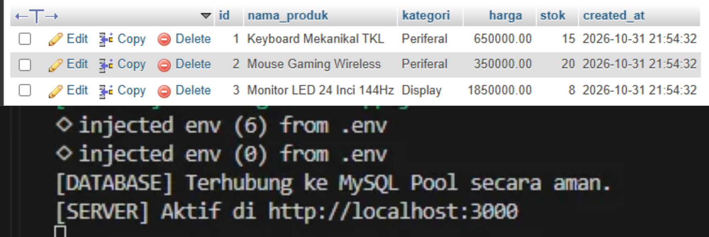
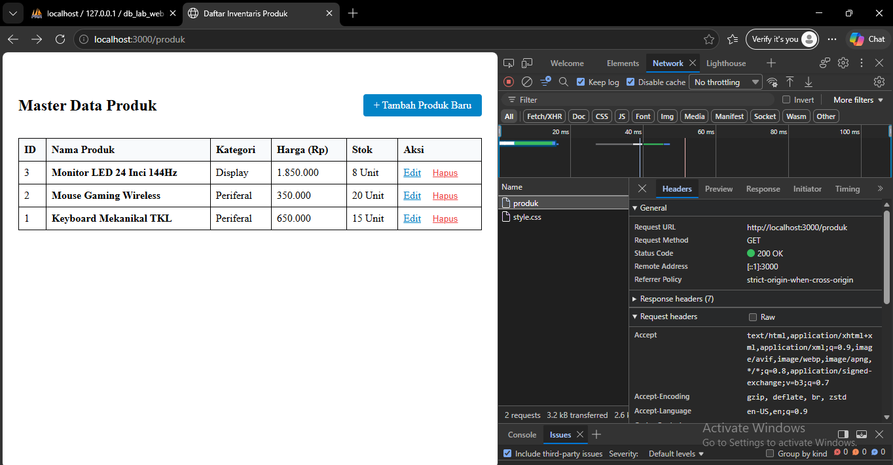
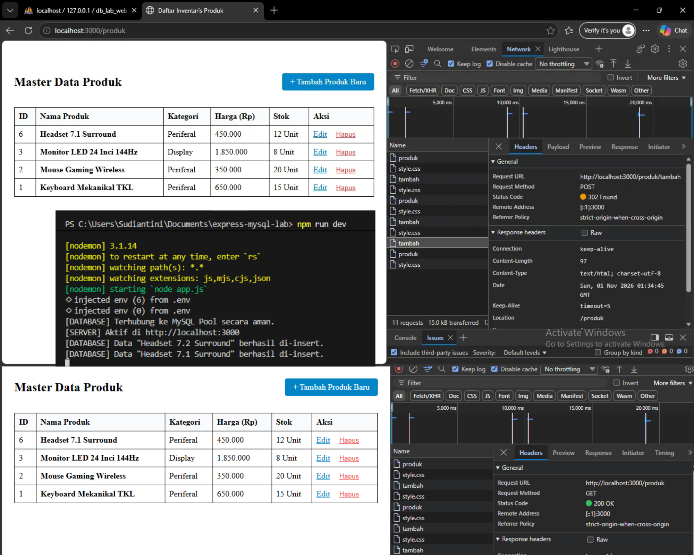
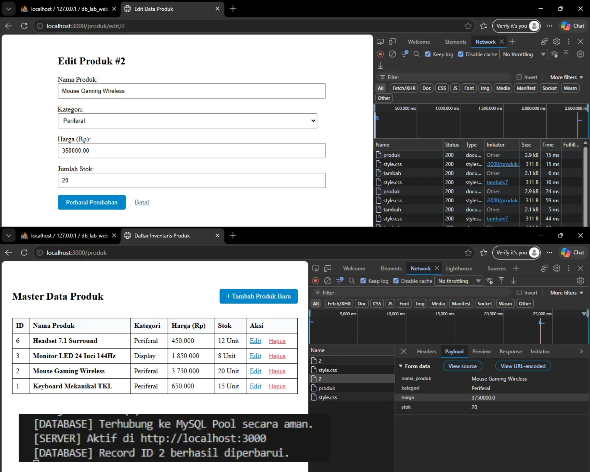
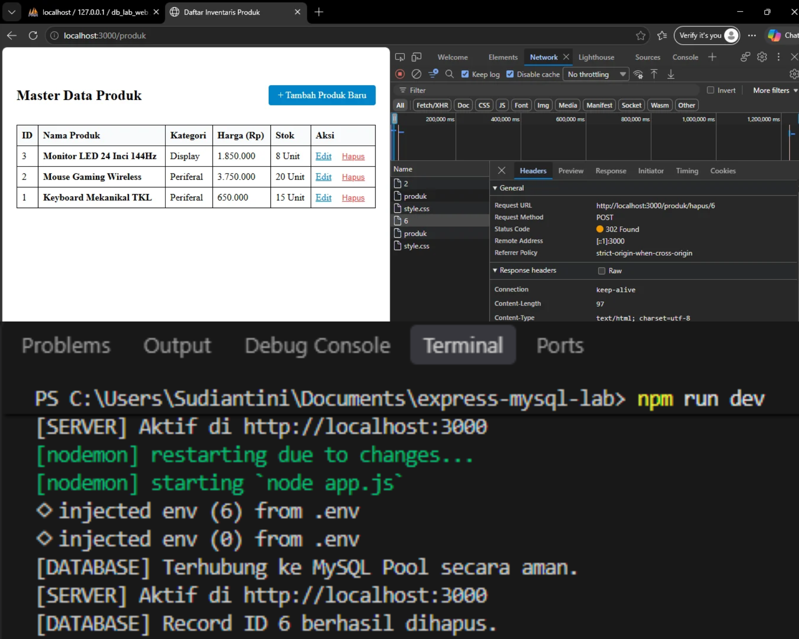
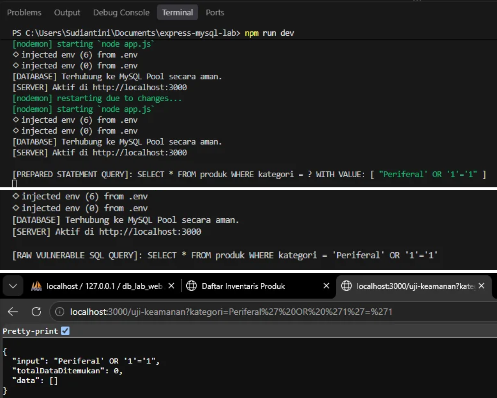

# Praktikum 3: CRUD Express + MySQL (Prepared Statements)

**Mata Kuliah:** Pemrograman Web (MK11)
**Nama:** Komang Widya Paramitha
**NIM:** 42530005

## Deskripsi
Aplikasi CRUD manajemen produk dengan Node.js, Express, EJS, dan MySQL.
Fitur utama: connection pool (`mysql2/promise`), kredensial di `.env`,
arsitektur MVC, kueri berparameter (`?`), dan pola Post-Redirect-Get.

## Struktur Proyek
```
config/       koneksi database (connection pool)
models/       seluruh query SQL
controllers/  alur data
routes/       definisi endpoint
views/        template EJS
docs/screenshots/  bukti pengujian
```

## Cara Menjalankan
1. Jalankan MySQL (XAMPP) dan buat database dengan skema `produk`.
2. `npm install`
3. Salin `.env.example` menjadi `.env`, lalu isi kredensial database.
4. `npm run dev`
5. Buka `http://localhost:3000/produk`

## Matriks Penelusuran Pengujian (Traceability Matrix)

| ID Uji | Fitur / Operasi | Target Endpoint URL | HTTP Method | Skenario Pengujian | Hasil yang Diharapkan | Status | Bukti Tangkapan Layar |
|---|---|---|---|---|---|---|---|
| TC-01 | Koneksi Pool | App Startup | - | Server dijalankan pertama kali | Terhubung ke MySQL Pool tanpa error | Pass | [01-db-pool-connection.png](docs/screenshots/01-db-pool-connection.png) |
| TC-02 | Read (All) | /produk | GET | Akses halaman daftar produk | Menampilkan seluruh record tabel MySQL ke antarmuka EJS | Pass | [02-read-select-render.png](docs/screenshots/02-read-select-render.png) |
| TC-03 | Create | /produk/tambah | POST | Submit formulir produk baru | Data tersimpan di DB, DevTools mencatat 302 Redirect ke /produk | Pass | [03-create-insert-prg.png](docs/screenshots/03-create-insert-prg.png) |
| TC-04 | Update | /produk/edit/:id | POST | Mengubah harga & stok produk | Nilai kolom pada baris MySQL berubah sesuai input baru | Pass | [04-update-param-redirect.png](docs/screenshots/04-update-param-redirect.png) |
| TC-05 | Delete | /produk/hapus/:id | POST | Eksekusi tombol hapus produk | Baris record terhapus dari MySQL dan UI ter-refresh | Pass | [05-delete-feedback.png](docs/screenshots/05-delete-feedback.png) |
| TC-06 | Keamanan | /uji-keamanan | GET | Input `' OR '1'='1` via URL | Prepared Statement memperlakukan input sebagai literal string (No Injection) | Pass | [06-sql-injection-mitigation.png](docs/screenshots/06-sql-injection-mitigation.png) |

## Pengujian Troubleshooting

| ID | Kasus | Penyebab | Perbaikan | Bukti |
|---|---|---|---|---|
| TS-01 | Access Denied | `DB_PASSWORD` di `.env` salah | Kembalikan kredensial benar, restart server | [07-error-access-denied.png](docs/screenshots/07-error-access-denied.png) |
| TS-02 | Bind parameters undefined | Atribut `name` form tidak cocok dengan controller | Samakan `name` di form dengan variabel controller | [08-error-undefined-bind.png](docs/screenshots/08-error-undefined-bind.png) |
| TS-03 | Pool exhaustion | `connectionLimit: 1` dan koneksi tidak di-release | Batas pool 10, pakai `db.query()` dari pool | [09-pool-exhaustion.png](docs/screenshots/09-pool-exhaustion.png) |

## Bukti Pengujian






